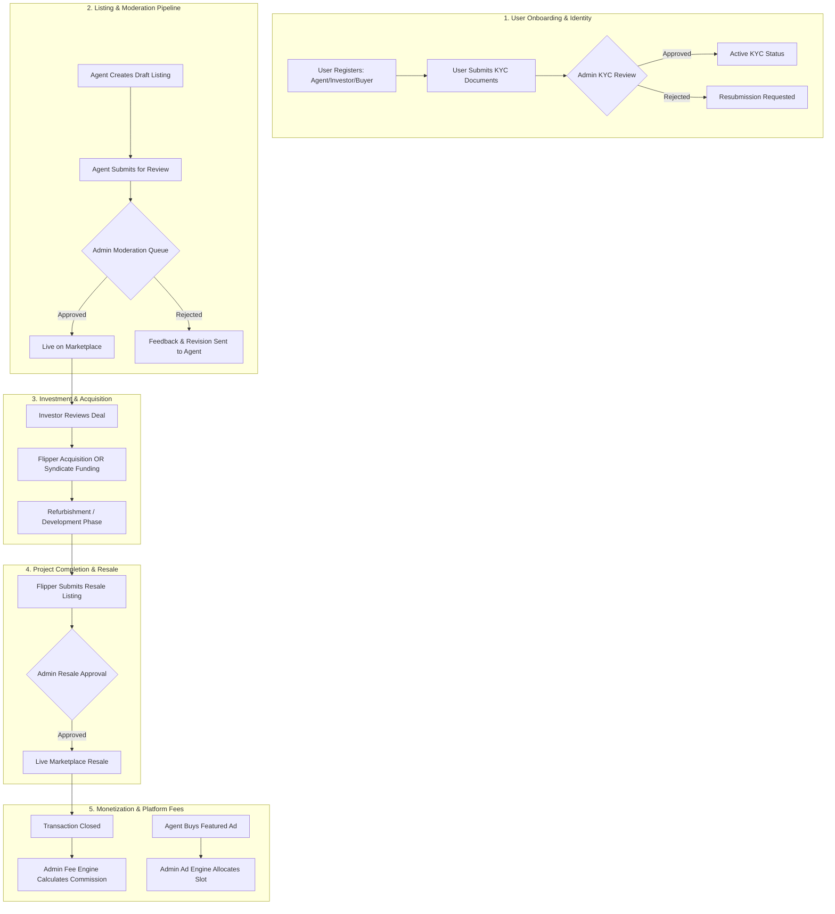

# PropLink Admin Workflow & Capabilities Analysis

**Document Version:** 1.0.0  
**Date:** October 8, 2026  
**Status:** Architecture & Design Specification  
**Target Surface:** PropLink Administrative Portal (`/admin/*`)

---

## 1. Executive Summary & Platform Overview

**PropLink** is a specialized UK property technology platform connecting deal sourcers/estate agents, distress property investors (flippers and syndicate backers), and retail buyers. The platform operates on a multi-sided marketplace model focused on distressed real estate, BMV (Below Market Value) acquisitions, refurbishment projects, and syndicate co-investment.

To maintain platform trust, legal compliance (UK AML/KYC standards), and financial integrity, the **Admin Portal (`/admin/*`)** serves as the central command center for platform governance. 

This document provides a complete audit of existing admin capabilities, maps out all business workflows from an administrative standpoint, identifies functional gaps, and proposes a comprehensive UI/UX overhaul to elevate the admin operational experience.

---

## 2. As-Is Admin Capabilities Audit

Currently, the PropLink platform includes the following administrative endpoints and governance controls:

| Admin Module | Route | Primary Responsibilities | Current Enforcement Status |
| :--- | :--- | :--- | :--- |
| **Admin Security Portal** | `/admin/login` | Isolated authentication for `Role.ADMIN` users with strict boundary check against standard users. | ✅ Implemented & Isolated |
| **Admin Command Dashboard** | `/admin` | Overview of pending moderation queues, quick links to operational portals. | ✅ Implemented (Basic layout) |
| **KYC & Identity Queue** | `/admin/kyc` | Reviewing uploaded identity documents, proof of funds, and approving/rejecting user KYC (`KycStatus.APPROVED` / `REJECTED`). | ✅ Implemented (`KycQueueClient.tsx`) |
| **Listing Moderation Queue** | `/admin/moderation` | Reviewing agent-submitted listings, verifying title deeds & distress classification, approving (`ACTIVE`) or rejecting (`REJECTED`) listings. | ✅ Implemented (`ModerationQueueClient.tsx`) |
| **Ad Network & Promotions** | `/admin/ads` | Managing featured placement slots, banner ads, agent promotion campaigns. | ✅ Implemented (`AdsManagementClient.tsx`) |
| **Fee & Commission Engine** | `/admin/fees` | Setting platform commission rates, syndicate management fee caps, and transaction fees. | ✅ Implemented (`FeeSettingsClient.tsx`) |
| **Flipper Resale Governance** | Server Actions / API | Validating project completion metrics and approving flipper resale listings (Phase 8). | ✅ Implemented (Phase 8 API) |

---

## 3. End-to-End Platform Workflows & Admin Touchpoints



### Business Workflow Details:

#### Workflow 1: User Onboarding & Identity Governance
* **User Trigger**: Agents and Investors register and upload proof of identity, address, and funds.
* **Admin Actions**:
  * Inspect submitted passport/driving license scans and proof of address.
  * Verify investor category (Flipper vs. Syndicate Investor eligibility).
  * One-click Approve (`KycStatus.APPROVED`) or Reject with structured audit failure reason codes.
  * Capability to suspend/deactivate fraudulent accounts.

#### Workflow 2: Property Listing Moderation & Quality Control
* **User Trigger**: Agents submit new distress properties (Repossession, Auction, Probate, Un-mortgageable, Severe Refurbishment).
* **Admin Actions**:
  * Validate ownership documents, EPC ratings, valuation comps, and structural reports.
  * Verify BMV discount claims (e.g., 20%+ below market value).
  * Approve for public marketplace publication or Reject with specific feedback for agent correction.
  * Feature high-value listings on homepage carousel.

#### Workflow 3: Syndicate & Flipper Project Governance
* **User Trigger**: Flipper investors complete property acquisitions and refurbishments; Syndicate deals raise capital.
* **Admin Actions**:
  * Monitor project progress milestones and capital deployment.
  * Audit profit-sharing calculations for syndicate pools.
  * Approve Phase 8 resale listings with verified profit estimates prior to public launch.

#### Workflow 4: Ad Network & Promotion Monetization
* **User Trigger**: Estate agents purchase top-tier placement or category sponsorship.
* **Admin Actions**:
  * Configure available ad slots (Homepage Hero, Search Header, Category Tile banners).
  * Review ad media for brand compliance.
  * Set run dates, impression targets, and pricing tiers.

#### Workflow 5: Fee Architecture & Financial Oversight
* **User Trigger**: Transactions complete across acquisition and resale phases.
* **Admin Actions**:
  * Define global platform fee rules (e.g., 1.5% finder fee, 2.0% syndicate management fee).
  * View fee collections and override fees for special partner deals.

---

## 4. Proposed Admin Capabilities (To-Be Expansion Roadmap)

To transform the Admin Portal into an enterprise-grade Operations Management Platform, the following new capabilities should be added:

### 4.1 Master Operations Dashboard (`/admin`)
* **Real-time KPI Counter Tiles**:
  * Total Active Listings vs. Pending Moderation Queue count.
  * Unverified KYC Applications with SLA timer indicators.
  * Total Marketplace GMV (Gross Merchandise Value) and Revenue collected.
  * Active Syndicate Pool Capital and Flipper project count.
* **Urgent Action Stream**: Highlighting items requiring attention within 24 hours (e.g., long-standing KYC reviews, flagged listings).

### 4.2 Comprehensive User Management & Directory (`/admin/users`)
* **Global User Search & Filter**: Filter by Role (Admin, Agent, Investor, Buyer), KYC status, creation date, and account status.
* **User Profile Detail View**:
  * Linked listings, active enquiries, syndicate investments, and complete transaction history.
  * Direct role override controls (e.g., elevating trusted agents, resetting KYC).
  * Single-click Account Ban / Freeze with security notification.

### 4.3 Audit Logging & Compliance Ledger (`/admin/audit`)
* **System Audit Log**: Full trail of all administrative actions (moderation approvals, KYC state changes, fee updates, user bans).
* **GDPR & Erasure Management**: Handling data subject deletion requests (`/admin/erasure`), verifying erasure compliance while retaining required financial transaction records under UK tax laws.

### 4.4 Advanced Moderation Studio (`/admin/moderation/[id]`)
* **Side-by-Side Comparison Workspace**:
  * Left side: Agent submitted details, comps, photos, and legal docs.
  * Right side: Automated valuation estimation, Land Registry verification status, and decision panel.
* **Rejection Reason Presets**: Fast multi-select rejection feedback (e.g., "Missing Title Document", "Unrealistic Valuation", "Blurry Images").

### 4.5 Financial & Revenue Analytics (`/admin/analytics`)
* **Platform Earnings Overview**: Detailed breakdown of listing promotion revenue, transaction finder fees, and syndicate management cuts.
* **Pipeline Velocity Metrics**: Average time to approve KYC, average time from listing submission to deal sale.

---

## 5. UI/UX Design System Improvements for Admin Portal

### Current vs. Enhanced Admin UI Specification

```
+-----------------------------------------------------------------------------------+
| PROPLINK ADMIN PORTAL                       [ Search... ] [ Notifications 🔔 ] [ Avatar ] |
+---------------+-------------------------------------------------------------------+
| 📊 Overview   |  +----------------+  +----------------+  +----------------+       |
| 👥 Users      |  | Pending KYC    |  | Pending Listings|  | Monthly GMV    |       |
| 🛡️ Moderation  |  | 14 Action Req. |  | 8 To Review    |  | £2.4M (+12%)   |       |
| 📢 Ads        |  +----------------+  +----------------+  +----------------+       |
| 💳 Fees       |                                                                   |
| 📜 Audit Log  |  +-------------------------------------------------------------+  |
| ⚙️ Settings   |  | Moderation Queue - Split Workspace                           |  |
|               |  |                                                             |  |
|               |  | Property: 12 Regent Terrace, Edinburgh                     |  |
|               |  | Agent: Apex Properties Ltd | Distress Type: Probate          |  |
|               |  |                                                             |  |
|               |  | [ Approve Listing ]  [ Request Revisions ]  [ Reject ]      |  |
|               |  +-------------------------------------------------------------+  |
+---------------+-------------------------------------------------------------------+
```

### Key UI Design Improvements:

1. **Dark Security Theme Accent**:
   * Elegant deep emerald/slate background (`bg-[#062319]` / `bg-[#0a0f1d]`) with crisp white card containers (`bg-card/90 backdrop-blur`) for a high-end financial terminal aesthetic.
2. **Compact Table & Data Grid Architecture**:
   * Sticky headers, inline filter bars, batch selection checkboxes, and status pills (`APPROVED` green, `PENDING` amber, `REJECTED` red).
3. **Split-Screen Workspace for Review Tasks**:
   * Eliminates context switching by allowing admins to view property media/PDFs alongside decision inputs.
4. **Toast Notifications & SLA Countdown Timers**:
   * Visual indicators showing how long items have been waiting in queue (e.g., `< 2 hrs` green badge, `> 24 hrs` red alert badge).

---

## 6. Recommended Action Plan & Next Steps

1. **Phase 1**: Align with stakeholders on the Admin Specification (this document).
2. **Phase 2**: Implement the Master Admin Dashboard layout (`/admin/page.tsx`) with real-time stats tiles and urgent action stream.
3. **Phase 3**: Upgrade `/admin/kyc` and `/admin/moderation` with split-screen detail views and quick rejection presets.
4. **Phase 4**: Implement Global User Management (`/admin/users`) and Audit Logging (`/admin/audit`).
5. **Phase 5**: Polish Admin Theme & UI token integration across all `/admin/*` sub-routes.
