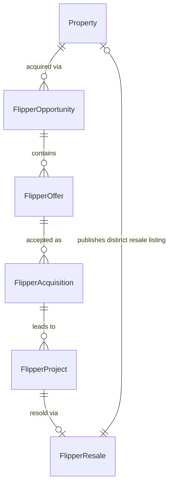

# Phase 8 — Flipper Resale & Exit Workflow Architecture

## 1. Physical Property vs Marketplace Listing Architecture

In PropLink, `Property` serves as the public **marketplace listing** entity:
- A physical property asset can have multiple listing records over its lifecycle.
- **Original Acquisition Listing**: `Property` record #1 (e.g. `listingSource = AGENT`, `status = SOLD`, linked to `agentProfileId`).
- **Flipper Resale Listing**: `Property` record #2 (e.g. `listingSource = FLIPPER_RESALE`, `status = LIVE`, `agentProfileId = null`, linked to `FlipperResale.resalePropertyId`).

---

## 2. Historical Integrity Preservation

The following historical acquisition & refurbishment records remain strictly immutable upon resale publication:
- Original acquisition `Property` row (`askingPriceGBP`, `publishedAt`, `status`, `agentProfileId`, `description`, media)
- `FlipperOpportunity`
- `FlipperOffer`
- `FlipperAcquisition`
- `FlipperProject`
- `FlipperProjectCost`
- `FlipperProjectMilestone`

The original acquisition marketplace listing is **NEVER mutated or reused** for the resale.

---

## 3. Distinct Resale Marketplace Listing

When an Admin approves a `FlipperResale`:
1. A **DISTINCT new `Property` record** is created:
   - `id`: new unique CUID (different from original acquisition listing ID)
   - `listingSource`: `FLIPPER_RESALE`
   - `status`: `LIVE`
   - `askingPriceGBP`: `resale.estimatedAskingPriceGBP`
   - `agentProfileId`: `null` (no Agent ownership cloned)
   - `publishedAt`: `now`
2. Physical property attributes (`title`, `addressLine1`, `city`, `region`, `postcode`, `location`, `propertyType`, `bedrooms`, `epcRating`) are copied from the physical property reference.
3. Media images are duplicated for the new listing entity.
4. `FlipperResale` stores `resalePropertyId` referencing the new `Property` row.

---

## 4. Atomic & Idempotent Publication

- Publication is executed atomically via database transactions and race-safe `$executeRaw` updates.
- Duplicate or concurrent publication calls check `FlipperResale.resalePropertyId` idempotently and return the existing resale marketplace listing without creating duplicates.

---

## 5. Marketplace Search & Routing

- Public marketplace search (`queryBuilder.ts`) queries `Property` where `status IN ('LIVE', 'UNDER_OFFER')`.
- The new `FLIPPER_RESALE` property listing (`status = LIVE`) is returned in marketplace search results upon approval.
- The original acquisition property listing remains `SOLD` and is not reactivated.

---

## 6. Buyer Transaction Fail-Closed Rules

Because Flipper Resales do not have an assigned Agent (`agentProfileId = null`), direct buyer transaction APIs fail closed:
- **Enquiries**: `createEnquiry` throws a `FORBIDDEN` error.
- **Viewings**: `requestViewing` returns `{ ok: false, error: "Direct viewing bookings for Flipper resale listings are not currently supported." }`.
- **Offers**: `submitOffer` returns `{ ok: false, error: "Direct buyer offers on Flipper resale listings are not currently supported." }`.
- **Chat**: `sendMessage` returns `{ ok: false, error: "Property not available" }`.
